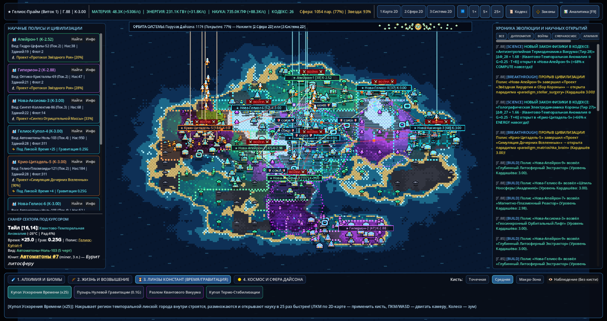
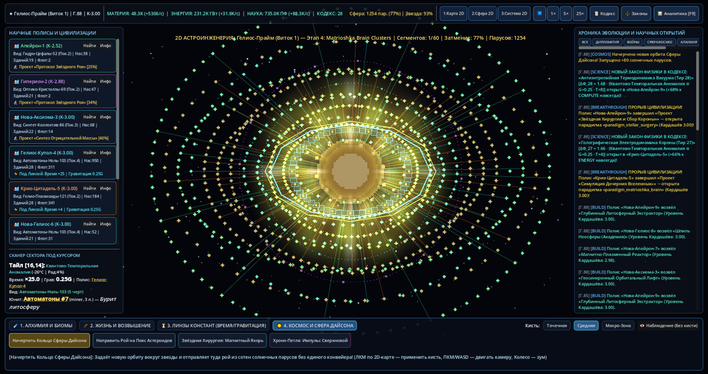
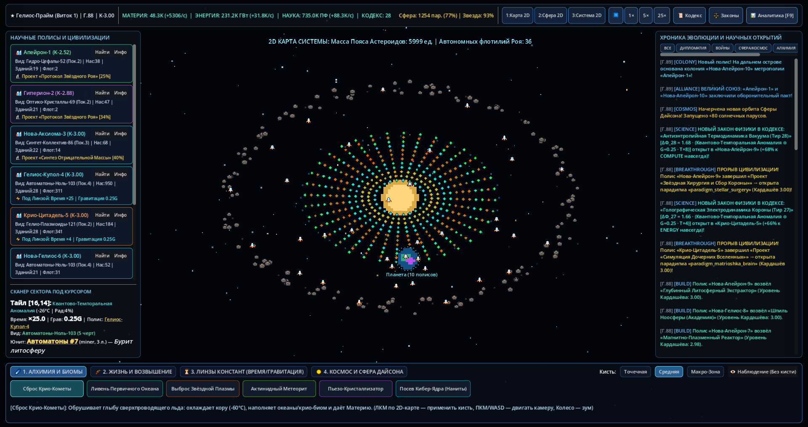
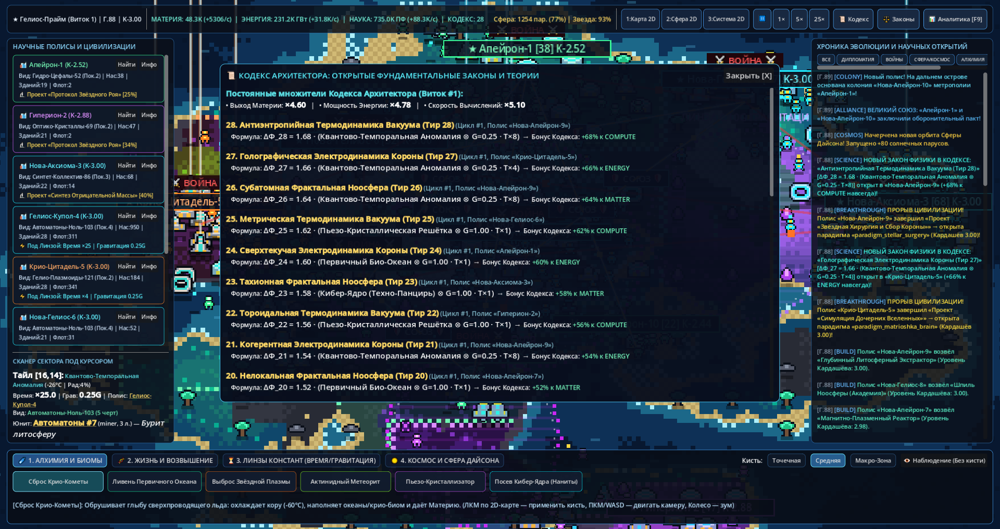

# Kardashev Sandbox: Crucible of Stars

**2D Pixel-Art Sci-Fi God Sandbox & Civilization Simulator (Godot 4.7.2 / GDScript 2.0)**

Симулятор эволюции цивилизаций по шкале Кардашёва (от планетарных полисов Типа 0 до межзвёздных империй Типа II–III и Мозга Матрёшки) в классической 2D пиксель-арт эстетике в духе *WorldBox*.



## Ключевые возможности

- **Эволюция цивилизаций и идеологии (`F1–F3`):**
  - 5 архетипов разумных рас (`carbon`, `silicon`, `plasma`, `cyber`, `quantum`), 22 генетические черты и 4 культурных этоса (`authoritarian_hive`, `technocratic_rationalism`, `spiritual_communion`, `libertarian_pioneers`).
  - Дипломатическая матрица (`PEACE`, `TRADE`, `ALLIANCE`, `WAR`), торговые караваны, военные лазерные конфликты и морские/орбитальные колониальные экспедиции.
- **4-стадийная Сфера Дайсона (`F4`):**
  - Последовательное возведение мегаструктуры вокруг звезды: *Рой Парусов (Stage 1)* → *Экваториальное Кольцо (Stage 2)* → *Сферическая Оболочка (Stage 3)* → *Мозг Матрёшки (Stage 4)*.
- **Арсенал Бога и Законы Физики (`F5–F6`):**
  - 29 божественных сил (терраформирование, посев жизни, монолит возвышения, линзы времени и гравитации, метеоритные удары, антиматерия, тектонические разломы, квантовые трансмутации).
  - 4 непрерывные фундаментальные константы мира ($G$, $c$, $\sigma$, $\mu$) и матрица из 7 реакций мульти-элементной алхимии тайлов.
- **Процедурный звук, 2D-шейдеры и Инспекторы (`F7–F9`):**
  - Безассетный процедурный синтезатор 29 звуковых профилей (`16-bit PCM WAV`, `22 050 Гц`, 4 шины `AudioServer`, пул из 24 источников).
  - 2D `CanvasItem`-шейдеры звездной короны (`shaders/dyson_aura.gdshader`) и гравитационных/ударных линз (`shaders/cosmic_lens.gdshader`).
  - 6 модальных окон (`Кодекс Науки [T]`, `Законы Мира [L]`, `Глобальная Аналитика [F9]`, инспекторы Полиса, Юнита и Культуры) и интерактивный лог событий с `Click-to-Pan` навигацией камеры.
- **Производительность и 25× ускорение времени (`F10–F11`):**
  - Частичное обновление текстуры карты `Dirty-Rect` (ускорение рендера в `144×`) и детерминированный сабстеппинг `50 мс` (`FIXED_SUBSTEP_DT = 0.05`) без потери тиков на скорости `25×`.
  - 20 автоматизированных headless-тестов (`run_all_tests.ps1`, `100% PASS`).

## Скриншоты

| 2D Сфера Дайсона | 2D Звёздная Система | Кодекс Бесконечной Науки |
| :---: | :---: | :---: |
|  |  |  |

## Запуск игры и тестов (Windows PowerShell)

```powershell
# Запуск игры с графическим окном (Godot 4.7.2)
& (Resolve-Path ".\run_game.ps1").Path

# Запуск полного набора из 20 автоматических E2E и стресс-тестов
& (Resolve-Path ".\run_all_tests.ps1").Path
```
